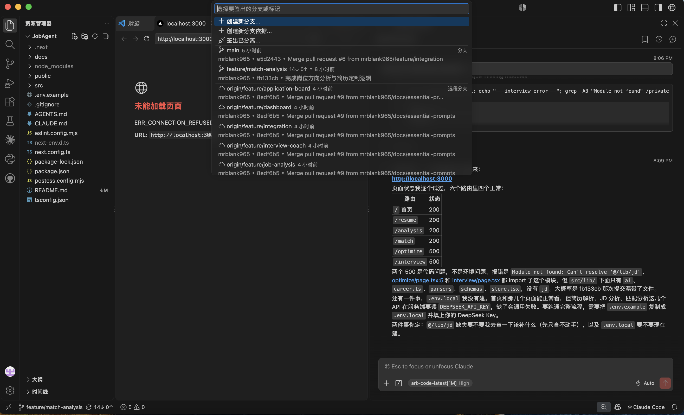
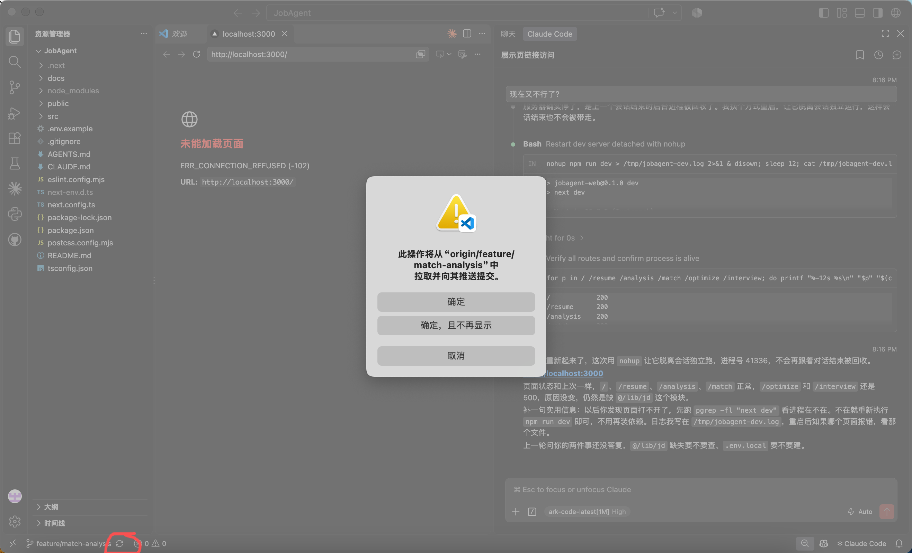
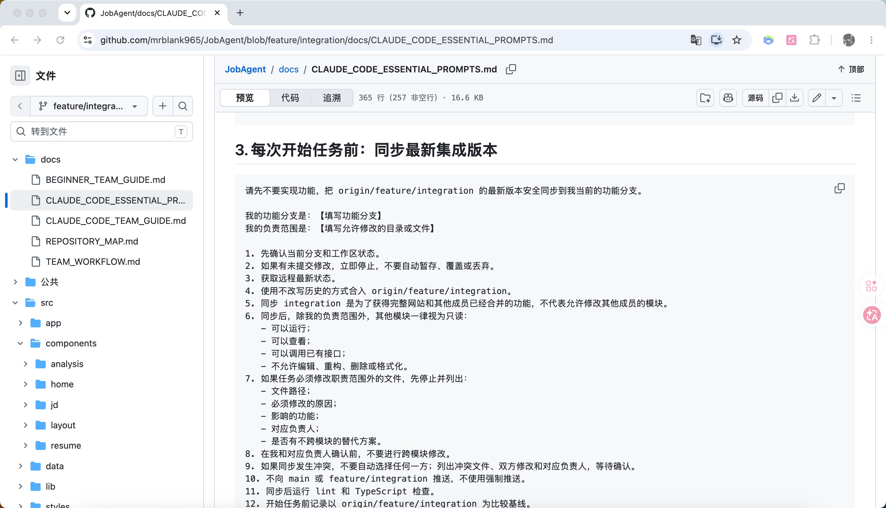
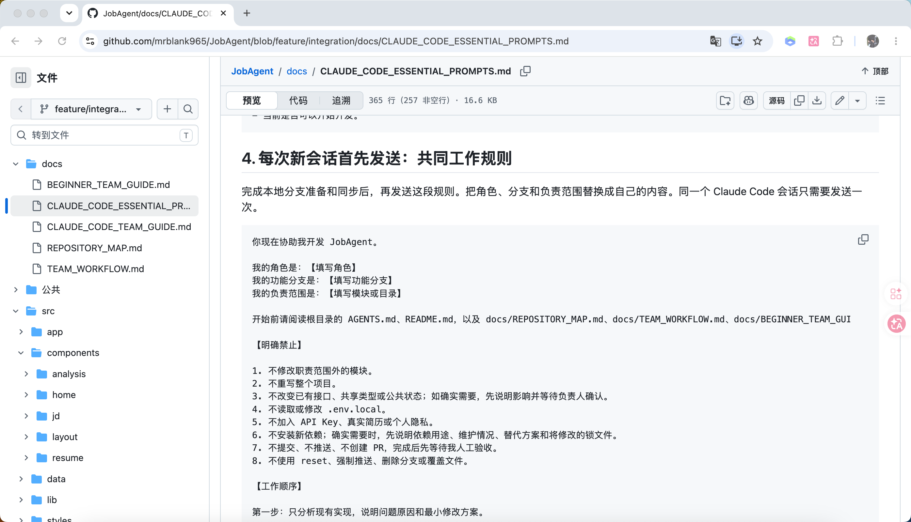
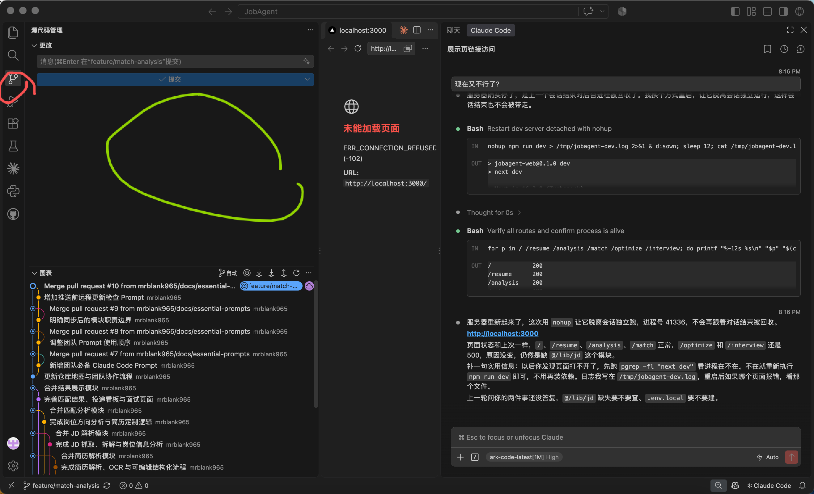

# 从零搭建到团队交付：GitHub × VS Code × AI 编程助手协作指南（通用版）

> 适用对象：使用 GitHub 管理代码，并通过 VS Code、Claude Code、Codex 或其他 AI 编程助手协作的学生团队、小型项目组和初学者。  
> 本文不绑定具体仓库、技术框架或业务模块。请把示例中的分支名称、检查命令和职责范围替换为团队自己的约定。  
> 配套文档：[AI 编程团队协作必备 Prompt（通用版）](./AI_CODING_TEAM_ESSENTIAL_PROMPTS.md)

---

## 1. 一张图看懂完整流程

推荐采用三层分支结构：

```text
main（稳定、可展示或可发布版本）
  ↓ 每轮开始时由负责人同步
feature/integration（集成、联调和发布候选版本）
  ↓ 成员开始任务前同步
feature/*（功能或任务分支）
  ↓ 本地修改 → 人工验收 → Commit → 检查远程 → Push
远程 feature/*
  ↓ Pull Request，目标选择 feature/integration
feature/integration（审核、合并和全项目联调）
  ↓ 全部验收通过后创建最终 Pull Request
main
```

一句话概括：

> 成员从 integration 获取公共版本，在自己的 feature 分支开发；功能完成后先进入 integration 联调，整轮稳定后再由负责人把 integration 合入 main。

这套流程可以降低以下风险：

- 半成品直接进入正式版本；
- 多人同时修改导致相互覆盖；
- AI 擅自扩大修改范围；
- 单个功能正常但组合后无法运行；
- 出现问题时找不到来源。

---

## 2. 先理解五个基本概念

### 2.1 仓库 Repository

仓库保存完整项目和版本历史。GitHub 上的是远程仓库，成员电脑中的是本地克隆。

网页下载 ZIP 不等于克隆仓库。ZIP 通常没有 Git 历史，不能正常拉取、提交和推送。

### 2.2 分支 Branch

分支是同一个项目中的一条开发路线，不是单独的业务文件夹。

- 一个本地项目文件夹可以切换多个分支；
- 切换分支后，文件显示为该分支的版本；
- 每条功能分支通常都包含完整项目；
- 拥有完整项目不代表可以修改所有模块。

### 2.3 工作区 Working Tree

工作区是当前文件夹中尚未提交或已经检出的文件。AI 修改代码后，变化首先出现在工作区。

### 2.4 提交 Commit

Commit 是本地 Git 历史中的一次版本快照。

```text
修改文件 ≠ Commit
Commit ≠ Push
Push ≠ Pull Request
```

### 2.5 Pull Request（PR）

PR 是在 GitHub 上提出的分支合并申请，不是下载代码的 pull。

```text
功能 PR：base = feature/integration，compare = 功能分支
最终 PR：base = main，compare = feature/integration
```

创建 PR 不等于合并。审核者确认并执行合并后，目标分支才会发生变化。

---

## 3. 为什么需要 main、integration 和 feature

| 分支 | 用途 | 维护方式 |
| --- | --- | --- |
| `main` | 稳定、可演示或可发布版本 | 只接受经过集成验收的最终 PR |
| `feature/integration` | 下一版的集成和联调环境 | 接收功能 PR，检查公共接口和完整流程 |
| `feature/*` | 具体功能或任务的开发环境 | 成员在自己的职责范围内开发和测试 |

`feature/integration` 可以理解为下一版 `main` 的候选版本，而不是随意堆放代码的草稿箱。进入 integration 的功能也应先通过本模块检查。

### 3.1 功能分支如何命名

使用能表达职责的短名称，例如：

```text
feature/user-login
feature/search
feature/dashboard
feature/payment
feature/report-export
fix/mobile-navigation
docs/team-guide
```

不要同时出现多种含义相同的名称，例如同时使用 `feature/login`、`feat/sign-in` 和 `feature/user-auth`，否则容易选错分支。

### 3.2 如何划分成员职责

每项工作至少明确：

- 当前功能分支；
- 负责人；
- 允许修改的目录或文件；
- 只读模块；
- 共享文件；
- PR 的目标分支；
- 验收标准。

分支数量不必等于成员数量。一名成员可以负责多个紧密相关的分支；多人同时开发同一功能时，可以继续建立更小的任务分支。

---

## 4. 负责人从零搭建仓库

### 4.1 建立最小可运行底座

负责人先准备：

- 项目框架和目录约定；
- 公共入口、布局或基础服务；
- 共享类型和接口约定；
- `.gitignore`；
- `README.md`；
- 协作规则文档；
- 最小演示数据、空状态或测试入口。

底座的目标是让所有成员从同一套结构开始，而不是提前替每个人完成全部业务。

### 4.2 创建远程仓库

1. 在 GitHub 创建仓库；
2. 设置公开或私人权限；
3. 关联本地项目与远程仓库；
4. 确认远程名称为 `origin`；
5. 将稳定底座放入 `main`；
6. 从统一基线创建 `feature/integration`；
7. 从统一基线创建各功能分支；
8. 邀请成员并分配合适权限。

成员本人应登录 GitHub 接受邀请。不要在聊天中发送密码、验证码、Token 或 Cookie。

### 4.3 标记共享修改热点

不同项目的共享文件不同，常见类型包括：

- 全局布局和公共样式；
- 路由入口；
- 共享类型；
- 公共状态；
- API 契约；
- 数据库结构；
- 依赖清单和锁文件；
- 构建配置；
- CI 配置。

这些文件由负责人协调。功能成员确需修改时，应先说明原因和影响，并在 PR 中单独列出。

---

## 5. 成员第一次加入项目

### 5.1 准备条件

每位成员需要：

1. GitHub 账号；
2. 已接受仓库邀请；
3. Git；
4. VS Code 或其他编辑器；
5. 项目要求的运行环境；
6. 自己负责的分支和目录；
7. 可选的 AI 编程助手。

GitHub MCP、GitHub CLI 和 VS Code PR 扩展都不是必要条件。即使不使用这些工具，也可以通过 Git 和 GitHub 网页完成全部流程。

### 5.2 登录 GitHub

1. 在 VS Code 的账户菜单选择 GitHub 登录；
2. 在浏览器确认网址属于 `github.com`；
3. 由成员本人完成授权；
4. 不把密码、验证码或 Token 交给 AI。

### 5.3 正确克隆项目

在 VS Code 中选择“Git: Clone”或“克隆 Git 存储库”，粘贴团队提供的 HTTPS 仓库地址。

不要使用“Publish to GitHub”连接已经存在的团队仓库，也不要用网页下载 ZIP 代替 Clone。

### 5.4 第一次只检查连接

可以将以下 Prompt 发给 AI：

```text
请只检查当前项目与 GitHub 的连接状态，暂时不要修改代码、提交、推送或安装工具。

仓库地址：【仓库地址】
我的功能分支：【功能分支】

请检查：
1. 当前文件夹是否是真正的 Git 仓库，而不是 ZIP。
2. Git 是否可用。
3. origin 是否指向我提供的仓库地址。
4. 当前分支是什么。
5. 是否能读取 main、feature/integration 和我的远程功能分支。
6. 工作区是否有未提交修改。
7. Git 提交身份是否已经配置；不要自动修改或编造。

安全规则：
- 不读取环境变量文件；
- 不搜索或展示 Key、Token、密码和 Cookie；
- 不自动创建仓库；
- 不执行 git init、reset、强制推送、删除分支或覆盖文件；
- 需要登录时，只告诉我操作位置，由我本人完成授权。

最后用表格汇报“检查项目、结果、是否需要我操作、下一步”。
```

---

## 6. 截图版：VS Code 六步协作流程

> 截图来自一个示例项目。实际使用时以自己项目的仓库名和分支名为准。

### 第一步：确认自己的功能分支

成员电脑中通常只有一个项目文件夹。先看 VS Code 左下角的分支名称，确保当前是自己的 `feature/*`，不要在 `main` 或 `feature/integration` 上直接开发。

本地没有对应分支时，点击分支名称并选择 `origin/feature/...`。VS Code 通常会建立本地跟踪分支并切换过去。



### 第二步：开工前同步远程状态

左下角循环箭头通常表示“同步更改”，它可能同时执行拉取和推送，不是单纯的下载按钮。



开工前除了检查远程同名分支，还应将最新 integration 安全合入当前功能分支。不确定时先让 AI 检查：

```text
请先不要修改、提交或推送。检查当前分支、工作区、远程同名分支和 origin/feature/integration，告诉我“同步更改”按钮现在会执行什么，以及是否可以安全点击。如有未提交修改、远程新提交或冲突风险，请停止并说明。
```



### 第三步：先发共同规则，再发具体任务

每个新 AI 会话先发送一次共同工作规则，说明角色、分支、职责、安全限制和工作顺序。之后只需要发送简短任务。



完整模板见：[AI 编程团队协作必备 Prompt（通用版）](./AI_CODING_TEAM_ESSENTIAL_PROMPTS.md)。

### 第四步：检查 AI 修改的文件

点击 VS Code 左侧“源代码管理”，在“更改”区域查看本轮文件。



常见状态：

- `M`：文件被修改；
- `U`：新文件尚未跟踪；
- `A`：新文件已加入提交；
- `D`：文件被删除。

颜色会随主题变化，不要只根据颜色判断。应逐个检查差异，确认都属于本轮任务。

### 第五步：Commit 后 Push

点击“提交”只是把修改保存为本地 Commit。Commit 后，左下角可能出现向上箭头或 `1↑`，代表本地有提交尚未上传。


再次同步前应检查远程：

- 远程同名分支是否有其他成员的新提交；
- integration 是否在开发期间更新；
- 是否存在冲突；
- 工作区是否干净。

普通 Push 在远程领先时通常会被拒绝。不要使用强制推送绕过保护。

### 第六步：创建功能 PR

本地 Commit 推送到远程同名功能分支后，创建 PR：

```text
base：feature/integration
compare：自己的功能分支
```

创建 PR 只是在申请合并，不要立即自动合并。负责人或审核者应检查真实差异和验收结果。

---

## 7. AI 编程的标准工作顺序

```text
读取项目规则
→ 确认分支和职责
→ 分析现有实现
→ 提出最小方案
→ 列出计划修改文件
→ 人工确认
→ 小范围实现
→ 自动检查
→ 人工验收
→ Commit
→ 检查远程
→ Push
→ Pull Request
```

### 7.1 为什么不能一句“帮我全部做完”

AI 可能：

- 误解已有架构；
- 为一个小任务修改多个公共文件；
- 重写已经可用的实现；
- 安装不必要依赖；
- 顺便重构其他成员代码；
- 在没有验收时提交或推送。

因此应使用“先分析、列文件、人确认、最小修改”的模式。可以直接使用配套 Prompt 文档，不必每次重新编写长指令。

### 7.2 人工验收不能省略

AI 说“完成”只代表它认为任务完成。成员仍需亲自检查：

- 正常状态；
- 加载或等待状态；
- 空状态；
- 错误输入；
- 相关模块联动；
- 控制台和日志；
- 是否出现计划外变化。

---

## 8. Commit、Push 和 PR 的正确顺序

### 8.1 Commit

人工验收通过后，先确认：

- 当前在自己的功能分支；
- 差异属于本轮任务；
- 没有秘密、真实数据和个人隐私；
- 没有依赖目录、构建产物、缓存和日志；
- 项目要求的检查已经通过；
- Git 作者身份由成员本人确认。

然后创建本地 Commit，暂时不要 Push。

### 8.2 Push 前检查远程

两个人从同一个提交开始工作时，先 Push 的人会更新远程。后 Push 的人应先获取远程新增提交并安全合入本地。

```text
远程新增提交
→ 合入本地
→ 有冲突则停止并人工确认
→ 重新检查
→ 普通 Push
```

禁止使用强制推送覆盖他人历史。

### 8.3 Push

Push 只把本地提交上传到远程同名功能分支，不会自动改变 integration 或 main。

### 8.4 Pull Request

功能 PR 的目标应是 integration。审核发现问题后，开发者继续在原功能分支修复并 Push，原 PR 会自动更新，不需要重新创建 PR。

---

## 9. 负责人维护 integration 和 main

### 9.1 一轮开始前

负责人把远程最新 main 安全同步到 integration，运行基础检查后通知成员开始同步各自分支。

### 9.2 功能 PR 合入 integration

每个功能 PR 至少检查：

- base 和 compare；
- 职责范围；
- 公共文件变化；
- 接口、类型和数据结构；
- 对其他模块的影响；
- 自动检查和人工验收；
- 秘密、隐私和构建产物。

### 9.3 integration 全面联调

当计划内功能进入 integration 后，负责人检查：

- 核心端到端流程；
- 公共布局或服务；
- 跨模块接口；
- 数据兼容性；
- 重复实现和相互覆盖；
- 完整测试和生产构建。

### 9.4 最终 PR

只有完整联调通过后，才创建：

```text
base：main
compare：feature/integration
```

最终 PR 仍需负责人或指定审核者确认，不能因为单个功能已测试就跳过整体验收。

---

## 10. 冲突和“覆盖代码”的原理

### 10.1 哪些情况容易冲突

- 两个人修改同一文件的同一段；
- 一个人删除文件，另一个人继续编辑；
- 多人同时修改共享接口；
- 一个人重命名字段，其他人继续使用旧字段；
- AI 大范围格式化或重写文件。

### 10.2 普通 Push 通常不会悄悄覆盖远程

如果远程包含本地没有的提交，普通 Push 通常会被拒绝。这是保护机制。

真正危险的是：

- 强制推送；
- 冲突时无条件选择任意一方；
- 使用 reset 或覆盖文件丢弃修改；
- AI 未检查差异就重写整份文件。

### 10.3 发生冲突时

1. 停止自动处理；
2. 列出冲突文件；
3. 说明双方分别修改的业务；
4. 找到对应负责人；
5. 确认最终接口和用户行为；
6. 人工决定如何合并；
7. 重新运行检查和验收。

冲突并不等于项目损坏，它只是提醒团队有两个修改同时影响同一个决策点。

---

## 11. 安全和隐私底线

提交前确认没有：

- 真实环境变量文件；
- API Key、Token、密码和 Cookie；
- 真实用户数据和个人隐私；
- 依赖安装目录；
- 构建产物；
- 日志、缓存和临时文件；
- 与任务无关的大文件。

团队规则还应包括：

- 登录和验证码由成员本人处理；
- AI 不编造 Git 作者姓名和邮箱；
- 未确认前不安装或升级依赖；
- 不直接向 main 或 integration 推送功能代码；
- 不使用 reset、强制推送、删除分支或覆盖文件；
- 不让 AI 自动合并 PR。

---

## 12. 团队检查清单

### 12.1 成员开工前

- [ ] 已 Clone 正确仓库，不是 ZIP
- [ ] 当前在自己的功能分支
- [ ] 工作区没有来源不明的修改
- [ ] 已获取远程同名分支最新状态
- [ ] 已安全同步最新 integration
- [ ] 已声明允许修改范围
- [ ] 已发送共同工作规则

### 12.2 Commit 前

- [ ] 实际修改与确认方案一致
- [ ] 没有职责范围外的变化
- [ ] 没有秘密、真实数据和隐私
- [ ] 没有依赖目录和构建产物
- [ ] 相关检查、测试和构建通过
- [ ] 人工验收通过

### 12.3 Push 前

- [ ] 已获取远程最新状态
- [ ] 已比较远程同名分支
- [ ] 已比较最新 integration
- [ ] 远程新提交已安全合入
- [ ] 冲突已由负责人确认
- [ ] 没有使用强制推送

### 12.4 功能 PR

- [ ] base 是 integration
- [ ] compare 是自己的功能分支
- [ ] Changed files 没有无关变化
- [ ] 公共文件变化已单独说明
- [ ] 写明检查和人工验收结果
- [ ] 只创建，未擅自合并

### 12.5 最终发布

- [ ] 计划内功能已进入 integration
- [ ] 完成跨模块联调
- [ ] 公共接口和共享类型一致
- [ ] 完整检查和生产构建通过
- [ ] 最终 PR 是 integration → main
- [ ] 由负责人或指定审核者确认

---

## 13. 常见问题

### 分支是不是不同文件夹？

不是。一个克隆可以切换多个分支。需要同时打开多个分支时，可以使用 Git worktree，但 worktree 的外层目录只是本机组织方式。

### 功能分支能运行完整项目吗？

通常可以。功能分支包含完整项目，但只能看到当前分支已经拥有的版本。其他成员尚未合入 integration 的修改不会自动出现。

### 本地同步到远程是不是 PR？

不是。本地上传到远程同名分支叫 Push；PR 是远程分支之间的审核和合并申请。

### 点击提交是不是已经上传 GitHub？

不是。提交通常只创建本地 Commit，还需要检查远程并 Push。

### 同步按钮可以随时点吗？

不建议。它可能同时拉取和推送。当前分支不明确、工作区不干净或远程状态不清楚时，应先检查。

### AI 可以自动完成 Commit、Push 和 PR 吗？

技术上可能可以，但团队应分阶段授权：先修改和验收，再 Commit，再检查远程，再 Push，最后只创建 PR。每一步都应返回结果供成员确认。

### 必须配置 GitHub MCP 吗？

不必须。VS Code、Git 和 GitHub 网页已经能够完成完整流程。MCP、CLI 和扩展只是可选效率工具。

---

## 14. 适合发到团队群的极简流程

```text
1. 接受邀请，用 VS Code Clone，不下载 ZIP。
2. 切到自己的 feature 分支，一个项目文件夹即可。
3. 开工前检查工作区，并安全同步最新 integration。
4. 新 AI 会话先发送共同规则，再发送具体任务。
5. AI 先分析和列文件，人确认后再修改。
6. 完成自动检查并人工验收。
7. 验收后创建本地 Commit。
8. Push 前检查远程同名分支和 integration。
9. 普通 Push 到远程功能分支，禁止强制推送。
10. 创建 feature → integration 的 PR。
11. 负责人审核、合并并联调整体项目。
12. 一轮稳定后创建 integration → main 的最终 PR。
```

---

## 15. 最后的协作原则

最可靠的 AI 编程协作不是让 AI 一次做完，而是：

```text
边界清楚
→ 先看现状
→ 给出最小方案
→ 人工确认
→ 小范围实现
→ 自动检查
→ 人工验收
→ 保存版本
→ 比较远程
→ 审核合并
```

只要团队坚持这条链路，即使成员对 Git 不熟悉，也能知道每一步正在改变什么、风险在哪里，以及出现问题时应该停在哪一步。
